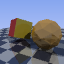
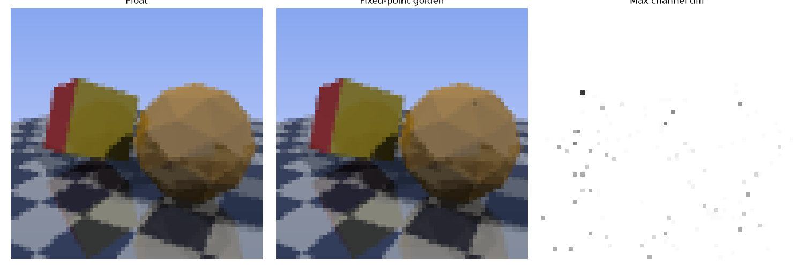
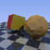

# FPGA Ray Tracer

A fixed-point (Q16.16) **ray tracer** written in Verilog, with a Python toolchain that exports scenes and produces a bit-accurate golden model. The RTL output is verified pixel for pixel against that model, and the full design is implemented for an Artix-7.

| Float reference | Fixed-point golden | RTL simulation |
|---|---|---|
|  |  |  |

## Features

This is ray tracing, not just ray casting: secondary rays are fired from every hit.

- Triangle meshes, with an OBJ loader and a built-in icosphere
- Shadow rays from **two lights**
- **Two-bounce reflections**
- Phong specular highlights
- Procedural checkerboard floor (no texture memory)
- 4x anti-aliasing (rotated-grid sampling)
- Movable look-at camera
- UART frame streamer (header + RGB bytes) for sending the image to a PC

## Architecture

```
scene.py ──> .mem files + rt_params.vh ──> Verilog (rt_trace_s)
                                              │
        ┌─────────────────────────────────────┤
        │  FSM (per pixel, per AA sample, per bounce)
        │   ├─ rt_intersect_s : Moller-Trumbore hit test
        │   │                   12 multipliers shared over 2 passes
        │   ├─ rt_div         : sequential restoring divider (t = tn / a)
        │   └─ shared 3-lane multiplier for all shading math
        ▼
   pixel RGB ──> BRAM framebuffer ──> UART  (board path)
             └─> hw_rt.txt ──> verify_rt.py (simulation path)
```

- **Division only after a confirmed hit.** The hit test compares `u*a`, `v*a` and `t*a` against `a`, so deciding hit or miss needs no division.
- **Shadow rays skip the divider.** They only need to know whether anything blocks the light.
- **Camera rays use running adds.** Pixel directions come from `D00 + px*DX + py*DY`, with no multipliers.

## Verification flow

1. `scene.py` writes the scene as fixed-point `.mem` files and `rt_params.vh`.
2. `golden_rt.py` is a bit-accurate Python model of the hardware math. It reads the same files the Verilog reads.
3. `rt_float.py` is an independent floating-point ray tracer.
4. The Verilog testbench (`tb_trace.v`) writes `hw_rt.txt`.
5. `verify_rt.py` compares `hw_rt.txt` with `golden_rt.txt` line by line.

| Check | Result                                                                |
|---|-----------------------------------------------------------------------|
| RTL vs fixed-point golden model | **0 mismatching pixels**                                              |
| Fixed-point vs float reference | 44.1 dB PSNR |
| Hit-test unit: 7,505 test vectors (2,702 hits) | **0 errors**                                                          |

## Implementation results

Full design (`top_uart`: ray tracer, framebuffer, UART streamer, MMCM) on the Artix-7 `xc7a35tcpg236-1`, 64x64 image, 50 MHz render clock, post-implementation:

| Resource | Used | Available | Utilization |
|---|---|---|---|
| LUT | 5,793 | 20,800 | 27.9% |
| FF | 3,034 | 41,600 | 7.3% |
| BRAM | 4 | 50 | 8.0% |
| DSP48 | 60 | 90 | 66.7% |
| MMCM | 1 | 5 | 20.0% |

| Timing (20 ns period) | Result |
|---|---|
| Worst setup slack (WNS) | **+7.411 ns**, 0 failing endpoints |
| Worst hold slack (WHS) | +0.045 ns, 0 failing endpoints |
| Estimated Fmax | about 79 MHz |

All user-specified timing constraints are met.

### How the design got here

| Design | LUTs                        | DSP48 | Timing |
|---|-----------------------------|---|---|
| First combinational ray caster (whole design) | 26,327 (127%, does not fit) | 89 / 90 | WNS -35.4 ns at 10 ns (about 22 MHz) |
| `rt_intersect_p`, 7-stage pipelined hit test (module only) | 3,219                       | 90 / 90 | WNS -1.4 ns at 10 ns (about 88 MHz) |
| `rt_intersect_s`, 12 shared multipliers over 2 passes (module only) | 1,835                       | 48 / 90 | met at 12 ns |
| **Final full design** | **5,793 (27.9%)**           | **60 / 90** | **met at 20 ns, WNS +7.4 ns** |

The pipelined hit test fixed timing but used every DSP. Sharing its multipliers cut that to 48. Moving the shading math onto a shared 3-lane multiplier brought the whole tracer, with camera, two lights, specular and anti-aliasing, to 60 DSPs and under 28% of the LUTs. The sequential divider is small (90 LUTs, 136 FFs).

## Repository layout

```
scene.py, meshes.py        scene definition, OBJ loader, .mem / .vh export
golden.py, golden_rt.py    fixed-point golden models
rt_float.py                floating-point reference
verify_rt.py               RTL vs golden comparison
receive_uart.py            PC-side UART image receiver
project_1/                 Vivado project
  project_1.srcs/sources_1/new/   RTL (rt_trace_s.v, rt_intersect_s.v, rt_div.v, uart_tx.v, top_uart.v)
  project_1.srcs/sim_1/new/       testbenches (tb_trace.v, tb_intersect_s.v, ...)
```

Older RTL versions (`rt_intersect.v`, `rt_intersect_p.v`, `rt_render.v`, `rt_trace.v`) are kept to show the optimization history.

## How to run

Requirements: Python 3 with `numpy` and `matplotlib` (plus `pyserial` for UART), and Vivado with xsim.

1. **Edit the paths.** The `.mem` files, `params.vh` and the testbenches use absolute paths of the form `C:/Users/khnay/Desktop/Ray/...`. Change them to your folder.
2. Generate the scene and references:
```
   python scene.py
   python rt_float.py
   python golden_rt.py
```
3. In Vivado, open `project_1/project_1.xpr`, set `tb_trace` as the simulation top, run Behavioral Simulation, then **Run All**. It writes `hw_rt.txt`.
4. Compare:
```
   python verify_rt.py
```
   Expect `Mismatching pixels: 0` and `PASS`.

Settings such as `RES`, `MESH`, the camera and the lights are at the top of `scene.py`. Use `RES = 32` for quick simulations.

## Limitations

- The design is verified in simulation and implemented with timing met, but it has not been run on a physical FPGA.
- The UART path was only checked on its own and has not been tested on hardware.
- No acceleration structure: render time grows with triangles x pixels, so this is a still-image renderer, not real-time.
- Scene tables are read through combinational logic, which is fine at this size but would move to BRAM for large meshes.
- Only triangles are supported. Spheres and refraction are not implemented.
- Ray directions are not normalized (that would need a reciprocal square root), so specular highlights are slightly brighter toward the image corners. The float and golden models use the same formula.

## Possible next steps

A board demo over UART or VGA, scene tables in BRAM for larger meshes, and spheres with an integer square-root unit.
